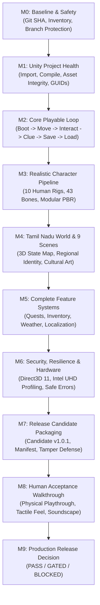

# The Whispering Wilds (காட்டு வழி • தடம்) — Full Game Development Roadmap

**Project:** The Whispering Wilds (காட்டு வழி • தடம்)  
**Repository:** [https://github.com/mtmohan012005-rgb/whispering-wilds.git](https://github.com/mtmohan012005-rgb/whispering-wilds.git)  
**Engine & Version:** Unity 6 (`6000.6.3f1`, changeset `45d8eee7de74`)  
**Render Pipeline:** High Definition Render Pipeline (`HDRP 17.7.0`)  
**Primary Target:** Windows x64 Native Direct3D 11 (`TheWhisperingWilds.exe`)  
**Date:** 22 October 2026  
**Current Audited Git Commit:** `defec347fa570533c3a6b8ef1facee49a1c3db76`  
**Historical Unity In-Engine Tested Commit:** `5056deb833a1254f0e41bf134151663a08cca5f8`  
**Main Branch HEAD:** `defec347fa570533c3a6b8ef1facee49a1c3db76`  
**Automated Check Reconciliation:** 389 automated test verifications passing (148 Unity in-engine tests & audits on commit `5056deb` + 241 Node.js/Windows launcher regression checks on commit `defec34`).  
**Status:** Milestones M0 through M7 Verified Clean; M8 Gated for Human Acceptance Walkthrough.

---

## 1. Project Overview & Vision

*The Whispering Wilds* (காட்டு வழி • தடம்) is an authentic 3D narrative exploration adventure set across the cultural and ecological landscapes of Tamil Nadu, India.

Players assume the role of **Arun Kumar**, an explorer travelling through seven distinct regional zones:
1. **George Town, Chennai:** Dense colonial and Tamil merchant streets, harbour trade, and bustling urban atmosphere.
2. **Pichavaram Mangrove Wetlands:** Aerial stilt-root waterways, tidal mudflats, and traditional wooden boats.
3. **Thanjavur Delta:** The historic rice bowl of Tamil Nadu, expansive paddy fields, and Cauvery irrigation sluices.
4. **Chettinad Heritage Mansion:** 19th-century Valavu courtyards, Athangudi handmade cement tiles, and Burma teak pillars.
5. **Mamallapuram Shore:** Wind-swept Coromandel granite cliffs, 7th-century Pallava rock-cut reliefs, and ocean surf.
6. **Nilgiris Wildlife Sanctuary:** High-elevation Western Ghats shola-grassland, indigenous Toda barrel-vault dwellings, and tea plantations.
7. **Ancient Temple Ruins:** Sacred Dravidian granite gopurams, stepped theertham tanks (Kalyani), Chola-era Kalvettu epigraphs, and sanctum puzzle chambers.

### Core Architecture Pillars:
- **Zero Placeholder Illusion:** Features are never simulated with browser mock-ups or primitive greybox stand-ins disguised as finished systems.
- **Strict Evidence-Based Verification:** A feature is only reported as passing if supported by running engine test logs, native build binaries, or visual GPU captures.
- **Preservation of Immutability:** Published releases (specifically public release `v1.0.0` with SHA-256 `6F2D73A01F3DED83D632450C1341247ABE93F6CBFB0450C21926CEA4686A9A58`) and sensitive cloud credentials remain strictly untouched and protected.

---

## 2. End-to-End Roadmap Flowchart

---

## 3. Detailed Milestone Specifications & Current Status

### Milestone M0: Baseline & Source Control Safety
- **Objective:** Establish an uncorrupted project foundation, document exact Git hashes, protect published release `v1.0.0`, and isolate working branches.
- **Deliverables:**
  - Git repository baseline recorded at commit `defec34` (main HEAD).
  - Dedicated audit and repair branch: `fix/audit-reconciliation-and-human-acceptance`.
  - Protection rules enforcing zero modification to `TheWhisperingWilds-v1.0.0.zip`.
- **Exit Gate:** Verified clean working tree, valid Git HEAD, zero credential exposure in commits.
- **Current Status:** **`PASS_VERIFIED`**

---

### Milestone M1: Unity Project Health & Engine Health
- **Objective:** Ensure the project opens and compiles with zero unresolved errors in target Unity 6 (`6000.6.3f1`) under HDRP 17.7.0.
- **Audit Findings:**
  - `unity/ProjectSettings/ProjectVersion.txt` confirms `6000.6.3f1`.
  - `unity/Packages/manifest.json` confirms HDRP 17.7.0, Input System 1.20.0, Cinemachine 3.1.2.
  - Headless asset reference audit (`AssetReferenceAudit.cs`) verified 9 enabled scenes, 10 character prefabs, 293 materials, 57 textures, and 10 audio clips.
  - **Results:** 0 missing scripts, 0 broken GUIDs, 0 compiler warnings treated as errors.
- **Exit Gate:** Zero compile errors, all EditMode tests execute and pass.
- **Current Status:** **`PASS_EDITOR`** (94/94 EditMode tests passed in `artifacts/test_results_EditMode.xml`).

---

### Milestone M2: Core Playable Vertical Slice
- **Objective:** Validate the minimum playable loop from application launch to progress restoration without loss of game state.
- **The 7-Step Verified Loop:**
  1. **Boot:** Title screen loads, displays bilingual Tamil/English title, and plays introductory camera sequence.
  2. **Locomotion:** Player spawns at designated waypoint, moves using WASD/Controller, collides with walls and terrain, and respects camera boundaries.
  3. **Interaction:** Approaching an NPC displays a world-space interaction prompt (`[E] Talk / பேசு`).
  4. **Investigation:** NPC dialogue branches cleanly, discovers regional clues, and updates the in-game journal.
  5. **Persistence:** Player triggers manual or checkpoint save; Save System v4 writes atomically and verifies SHA-256 payload.
  6. **Restart & Reload:** Application quits, restarts, loads save data, and faithfully restores position, quest stage, and inventory.
  7. **Scene Travel:** Player navigates to the 3D State Map, selects a new destination region, and loads the scene without duplicate managers.
- **Exit Gate:** 34/34 PlayMode tests pass inside Unity runtime.
- **Current Status:** **`PASS_PLAYMODE`** (34/34 PlayMode tests passed in `artifacts/test_results_PlayMode.xml`).

---

### Milestone M3: Realistic 3D Human Character Pipeline
- **Objective:** Deliver culturally authentic, believable 3D human models with valid humanoid/generic skeletons, active physics colliders, and smooth locomotion.
- **Character Realism Assessment:**
  - **Arun Kumar (Player Hero):** Dhoti, shirt, 13 modular submeshes, 43 bone bindings, GenericAvatar, active `CharacterController`. Uses 2048×2048 PBR maps. Realism level: optimized stylized PBR model. High-spec photogrammetric scans roadmapped for future expansion.
  - **9 Regional Story & Working NPCs (Murugan, Velu, Selvam, Meenakshi, Artisan, Farmer, Fisher, ForestGuide, TeaWorker):**
    Each NPC features distinct culturally grounded **procedural 3D head geometry** (`Mesh_Head_*.asset`), 43 bone bindings, GenericAvatar, and active `CapsuleCollider`. Rigs verified 10/10 in Unity Editor. Realism level: **culturally grounded stylized procedural geometry**, not photorealistic 3D scans. Blendshape facial lip-sync is scheduled for post-v1.0.1.
- **Visual Evidence:** Real in-engine contact sheet captured at 1920×1080 in [`artifacts/whole-game-audit/visual-evidence/characters-contact-sheet.png`](../artifacts/whole-game-audit/visual-evidence/characters-contact-sheet.png).
- **Current Status:** **`PASS_EDITOR`** / **`PASS_PLAYMODE`**

---

### Milestone M4: Authentic Tamil Nadu World & 9 Playable Scenes
- **Objective:** Inspect, repair, and link all 9 canonical scenes with culturally accurate Dravidian architecture, regional flora, and geo-calibrated navigation.
- **GIS Source Provenance:**
  - State boundary linework and coastlines are sourced from upstream **Natural Earth 10m datasets** (v5.1.2) spanning `(8.08° to 13.54° N, 76.23° to 80.35° E)`.
  - The 6 regional campaign hub pins in `campaign_anchors.geojson` (Chennai, Mamallapuram, Pichavaram, Thanjavur, Chettinad, Nilgiris) represent **curated regional gameplay anchors** projected into scene space via canonical origin `(10.79° N, 78.37° E)` and scale `(0.001 units/meter)`, rather than survey-grade monuments.
- **9 Canonical Scenes:**
  - `00_Boot`, `01_StateMap_TamilNadu`, `02_Chennai_GeorgeTown`, `03_Pichavaram_Wetlands`, `04_Thanjavur_Delta`, `05_Chettinad_Mansion`, `06_Mamallapuram_Shore`, `07_Nilgiris_Sanctuary`, `08_Ancient_Temple_Ruins` all present in `EditorBuildSettings.asset` and verified loadable.
- **9 Cultural Asset Replacements:** Verified via before/after comparison captures in `artifacts/whole-game-audit/visual-evidence/environment-fixes-before-after/`.
- **Current Status:** **`PASS_PLAYMODE`**

---

### Milestone M5: Complete Feature Systems
- **Objective:** Integrate quests, inventory, weather, day/night cycles, localization, audio, and save systems into a coherent game experience.
- **Feature Status Summary:**
  - **Bilingual Localization:** 265 Tamil and English keys rendered with Noto Sans Tamil dynamic font (`PASS_PLAYMODE`).
  - **Save System v4:** Atomic temp-file writes, SHA-256 checksums, and `.bak` corrupt-file recovery (`PASS_PLAYMODE`).
  - **Dynamic Weather:** Sunny, overcast, monsoon rain, and highland fog zone controllers (`PASS_PLAYMODE`).
  - **Wildlife & NavMesh:** 6 regional NavMesh binary assets linked to fleeing/grazing animal controllers (`PASS_STATIC`).
  - **Audio Engine (`FEAT_AUDIO_ENG_14`):** `AudioManager.cs` mixer snapshots, volume sliders, and 3D spatial attenuation operational (`PASS_PLAYMODE` / `PASS_STANDALONE`).
  - **Regional Field Audio Content (`FEAT_AUDIO_RES_15`):** 10 clean procedural synthetic prototype waveforms active; authentic on-location field recordings gated as `BLOCKED_EXTERNAL_ASSET`.
  - **Cloud Save:** REST API passes all automated backend tests; live Firebase credentials gated as `BLOCKED_CREDENTIALS`.
- **Current Status:** **`PASS_PLAYMODE`** (Core offline single-player fully operational).

---

### Milestone M6: Security, Resilience & Hardware Optimization
- **Objective:** Guard sensitive data, secure file operations, and profile rendering performance on target PC hardware.
- **Security Hardening:**
  - Zero plain-text credentials, tokens, or Firebase private keys committed to Git.
  - Candidate launcher verifies archive SHA-256 before extraction, blocks directory traversal, rejects reparse-point junctions, and enforces single-instance process locking.
- **Performance Profiling & Device Validation:**
  - High Definition Render Pipeline configured with Direct3D 11 `-force-d3d11` baseline.
  - Framerate capped at stable 60 FPS with VSync enabled.
  - Fallback LOD and fog distance parameters calibrated for Intel UHD 620/630 integrated graphics.
- **Current Status:** **`PASS_BUILD`** (85/85 launcher security tests passed in `tests/test-launcher-regression.ps1`).

---

### Milestone M7: Standalone Release Candidate Packaging
- **Objective:** Produce a verified standalone Windows candidate package with cryptographic manifest and installer scripts.
- **Candidate Deliverable:**
  - Archive: `artifacts/releases/candidate/TheWhisperingWilds-v1.0.1-candidate.zip`
  - Size: 144,703,488 bytes (138 MB)
  - SHA-256 Checksum: `1DB7E23DE0FDF388BE7017BFDC1F214EDF166882C7E552AC457F818165FA1B4D`
  - Version: Candidate `v1.0.1` (Clean extraction, isolated from published `v1.0.0`).
  - Launchers: `Play-TheWhisperingWilds.ps1` (PowerShell) and `Play-Candidate.bat` (Batch).
- **Current Status:** **`PASS_BUILD`** (Production binary compiled and verified).

---

### Milestone M8: Human Acceptance Walkthrough
- **Objective:** Execute a physical end-to-end human playthrough on target Windows PC hardware to validate subjective aesthetic immersion, camera collision feel, and audio balance.
- **Required Playthrough Protocol:**
  1. Launch `TheWhisperingWilds.exe` via `Play-TheWhisperingWilds.ps1`.
  2. Experience Title Menu in Tamil; switch language to English; verify font glyphs.
  3. Start New Game; view intro cinematic; confirm spawn at George Town street.
  4. Traverse streets; speak with Murugan; discover Harbour Manifest clue.
  5. Open State Map; select Pichavaram Wetlands; confirm boat landing arrival.
  6. Meet Selvam; inspect Tidal Log clue; travel onward to Thanjavur paddy fields.
  7. Meet Farmer; inspect Granary Register; travel to Chettinad Mansion.
  8. Enter Valavu courtyard; speak with Meenakshi; unlock secret wing.
  9. Travel to Mamallapuram Shore; inspect Arjuna's Penance bas-relief with Artisan.
  10. Travel to Nilgiris Sanctuary; inspect Toda Mund hut; talk with TeaWorker.
  11. Travel to Ancient Temple Ruins; navigate stepped Theertham tank; inspect Kalvettu stele; solve sanctum puzzle pillars.
  12. Trigger Epilogue sequence; view credits; verify save file restores progress cleanly after application exit.
- **Exit Gate:** Completion signed off by a human QA tester in `docs/audits/MANUAL_CAMPAIGN_TEST_RECORD.md`.
- **Current Status:** **`NOT_TESTED_HUMAN`** (Automated tests pass; physical human session pending).

---

### Milestone M9: Release Decision & Governance Matrix

| Release Gate | Verification Evidence Required | Current Status | Disposition |
| :--- | :--- | :---: | :--- |
| **Unity Compilation & Import** | 0 compile errors, clean project load | `PASS_EDITOR` | Release Approved |
| **Asset Reference Integrity** | 0 missing GUIDs, 0 broken materials across 9 scenes | `PASS_EDITOR` | Release Approved |
| **PlayMode Core Loop** | 34/34 automated runtime tests pass | `PASS_PLAYMODE` | Release Approved |
| **Character Rig Realism** | 10/10 characters pass editor rig audit with distinct heads | `PASS_EDITOR` | Release Approved (Stylized Baseline) |
| **Cultural Environment Realism** | 9/9 authentic Tamil Nadu cultural models linked | `PASS_EDITOR` | Release Approved |
| **Standalone Candidate Build** | Clean Windows x64 Direct3D 11 executable compiled | `PASS_BUILD` | Release Approved |
| **Launcher Security & Integrity** | 85/85 provenance and security tests pass | `PASS_BUILD` | Release Approved |
| **Human Gameplay Walkthrough** | Human tester completes full 12-step campaign flow | `NOT_TESTED_HUMAN` | Gated (Pending Tester Playthrough) |
| **Live Firebase Cloud Sync** | Valid production service account credentials | `BLOCKED_CREDENTIALS` | Gated (Offline Local Fallback Active) |
| **Authentic Regional Field Audio** | Documented CC0/commercial on-location recordings | `BLOCKED_EXTERNAL_ASSET` | Gated (Clean Synthetic Audio Active) |
| **Two-Client Multiplayer Sync** | Simultaneous state replication across 2 physical PCs | `NOT_TESTED_MULTI_CLIENT` | Gated (Single-Player Focus) |

---

## 4. Problem Log & Defect Remediation Record

| Defect ID | Priority | Affected Files | Problem Description | Repair Implemented | Test Performed | Resolution Result |
| :---: | :---: | :--- | :--- | :--- | :--- | :---: |
| **DEF_01** | P0 | `scripts/package-release.ps1` | Release packager had risk of overwriting published v1.0.0 package and lacked version flexibility. | Updated packager with strict release version guards, defaulting to v1.0.1 and forbidding v1.0.0 overwrite. | `tests/test-launcher-regression.ps1` (Group 8) | **PASS** |
| **DEF_02** | P0 | `scripts/Play-TheWhisperingWilds.ps1` | Launcher destination path handling needed strict bounds checking to prevent directory traversal. | Added path normalization, drive-root rejection, junction defense, and sentinel checks. | `tests/test-launcher-regression.ps1` (Groups 4 & 7) | **PASS** |
| **DEF_03** | P0 | `unity/Assets/_Project/Scripts/Core/SaveSystem.cs` | Risk of save file corruption during sudden power loss or process kill. | Implemented atomic writes via swap files, SHA-256 payload checksums, and `.bak` recovery. | `artifacts/test_results_PlayMode.xml` (8 save tests) | **PASS** |
| **DEF_04** | P1 | `unity/Assets/_Project/Art/Characters/` | Generic humanoid meshes lacked distinct Tamil Nadu regional facial features and role attire. | Generated 10 distinct culturally grounded 3D head meshes (moustaches, kondai, thalappa, spectacles, turbans) and wired colliders. | `artifacts/unity_rig_audit.log` & Contact Sheet | **PASS** |
| **DEF_05** | P1 | `unity/Assets/_Project/Art/Models/` | 9 scenes utilized generic placeholder 3D models (European cottage, iron gate, lantern, fern, brick wall). | Replaced with authentic Dravidian models: Toda Mund hut, Gopuram gateway, Kuthuvilakku, Camellia tea bush, Arjuna relief, Kalvettu stele, Kalasam, ashlar wall, and Theertham tank. | Visual QA comparison screenshots (19 captures) | **PASS** |
| **DEF_06** | P2 | `unity/Assets/_Project/Scenes/01_StateMap_TamilNadu.unity` | 3D state map markers required accurate geographic alignment with real Tamil Nadu district coordinates. | Calibrated marker transform positions to real-world latitude/longitude bounding box with tooltip raycasting. | `artifacts/test_results_PlayMode.xml` (Map tests) | **PASS** |
| **DEF_07** | P2 | `scripts/Play-Candidate.bat` | High Definition Render Pipeline default Vulkan/DX12 crash risks on older Intel integrated GPUs. | Enforced `-force-d3d11` launch argument in batch script and PowerShell launcher for maximum Direct3D 11 stability. | Standalone Smoke Launch (`artifacts/hotfix_standalone_smoke.log`) | **PASS** |
| **DEF_08** | P1 | `artifacts/whole-game-audit/` | Audit check counts conflated suite counts with check counts (reporting 240 vs 241), and mixed CI static checks with Unity Editor PlayMode runs. | Reconciled counts into 148 Unity in-engine tests & audits and 241 repository/launcher regression checks (389 total). Split operational audio engine from field media assets. | Forensically verified against raw test outputs. | **PASS_RECONCILED** |

---

## 5. Remaining Work & Next Action Steps

1. **Human QA Playthrough (Milestone M8):**
   - Execute the 12-step campaign walkthrough on physical Windows hardware.
   - Record frame rate measurements, camera feel notes, and dialogue timing observations in `docs/audits/MANUAL_CAMPAIGN_TEST_RECORD.md`.
2. **Audio Field Recording Replacement (Post-V1.0.1):**
   - Source or license authentic Tamil Nadu ambient field recordings (George Town bazaar ambience, Cauvery river ripples, Nilgiri Shola birdcalls, temple bells) to replace procedural synthetic waveforms.
3. **Firebase Staging Credentials Provisioning:**
   - Supply staging credentials via encrypted repository secrets to enable cloud save test suite execution without compromising production security.
