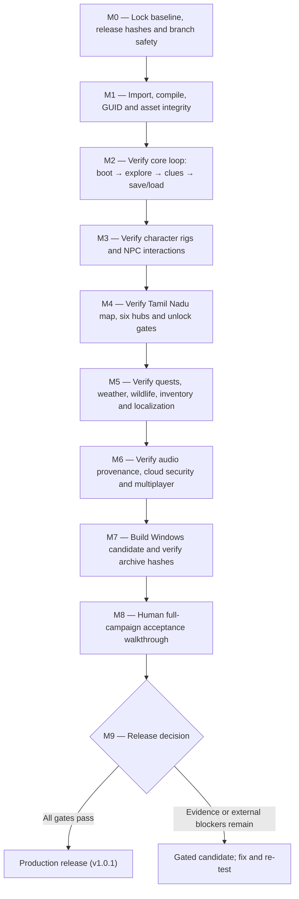

# THE WHISPERING WILDS — Full Game Project & Development Plan
**Tamil title:** காட்டு வழி • தடம்  
**Project type:** 3D narrative exploration adventure  
**Repository:** [https://github.com/mtmohan012005-rgb/whispering-wilds.git](https://github.com/mtmohan012005-rgb/whispering-wilds.git)  
**Repository snapshot checked:** `main` at `ace277facb27e749363d473c1ef1893cfb477408` (merge of PR #28, 26 October 2026)  
**Document prepared:** 1 November 2026  
**Primary engine:** Unity 6 `6000.6.3f1`  
**Renderer:** HDRP `17.7.0`  
**Primary platform:** Windows x64, Direct3D 11 baseline  

*This document combines the project's existing roadmap, architecture, campaign geography and latest repository findings into one readable project specification. It distinguishes repository facts, earlier test evidence and future design recommendations. It is not a claim that the latest main commit has just passed a fresh Unity build or human playthrough.*

---

## 1. Project Vision

*The Whispering Wilds* is a 3D narrative exploration game set across Tamil Nadu's cultural, historical and ecological landscapes. The player explores a connected campaign through real-world-inspired regional environments, meets local characters, investigates places and objects, records clues, unlocks destinations and solves environmental puzzles.

The project's central promise is to make Tamil Nadu itself feel like a character: its streets, water systems, coastlines, architecture, crafts, forests, weather, languages and everyday people should shape exploration and story progression.

### Core Pillars
- **Place-led exploration:** Every region has a recognisable geography, local identity, architecture, vegetation, wildlife and environmental soundscape.
- **Investigation, not combat-first gameplay:** Players discover clues, inspect objects, talk with NPCs, connect evidence and solve environmental puzzles.
- **Culturally grounded presentation:** Tamil and English text, Tamil Nadu-specific clothing and built forms, regional details and respectful treatment of local communities.
- **A coherent campaign:** Discoveries and conversations unlock later destinations; the journal and save system preserve progress.
- **Honest production quality:** Procedural or placeholder content must be labelled honestly. Stylised PBR models must not be described as photogrammetric or photorealistic scans.
- **Safe release engineering:** Preserve published release artifacts, protect credentials, validate content and publish evidence tied to exact Git commits.

---

## 2. Game Summary

| Item | Project Definition |
| :--- | :--- |
| **Working title** | The Whispering Wilds (காட்டு வழி • தடம்) |
| **Genre** | 3D narrative exploration / investigation adventure |
| **Main protagonist** | Arun Kumar, an explorer |
| **Main setting** | Tamil Nadu, India |
| **Core campaign** | Six geographic campaign destinations plus an Ancient Temple finale scene |
| **Languages** | Tamil and English |
| **Primary player mode** | Single-player campaign |
| **Additional online architecture** | Node.js / Socket.IO multiplayer services; live two-client play still needs acceptance testing |
| **Main platform** | Windows x64 standalone |
| **Engine** | Unity 6 HDRP |
| **Optional cloud persistence** | Firebase-backed service; local save remains the offline path |

### High-Level Premise
Arun Kumar follows a trail of historical records, environmental clues and personal testimonies across Tamil Nadu. What begins as a series of regional investigations gradually reveals connections between trade, water, craft, heritage and ecological change. The player gathers evidence from people and places, opens new routes through the campaign and eventually reaches an ancient temple complex where a folklore-inspired stone mechanism guards the Kaveri Star Seal.

*This paragraph is a concise narrative synthesis of the existing campaign material. The exact final dialogue, cinematic script and complete narrative text should remain owned by the in-game quest and dialogue data, not invented in this overview.*

---

## 3. Main Campaign and Regional Plan

The repository geography catalogue contains seven region records because Cauvery Delta and Thanjavur are separate geographic records that share one Unity scene. The campaign unlock system treats them as one destination. The campaign progression order is:

$$\text{Chennai} \longrightarrow \text{Pichavaram} \longrightarrow \text{Thanjavur / Cauvery Delta} \longrightarrow \text{Chettinad} \longrightarrow \text{Mamallapuram} \longrightarrow \text{Nilgiris} \longrightarrow \text{Ancient Temple Finale}$$

A new campaign initially makes Chennai, Pichavaram and Thanjavur available. Chettinad unlocks from a clue discovered in Thanjavur; Mamallapuram unlocks from a clue in Chettinad; Nilgiris unlocks from a clue in Mamallapuram. The Ancient Temple is a separate finale scene in the build list and is not currently one of the entries in `TamilNaduGeography.AllRegions`; therefore it is shown as a story destination, not assigned an invented geographic coordinate.

### Regional Content Specification

| Order | Region / Tamil Identity | Unity Scene | World Identity and Key Content | Main Story Interaction / Evidence |
| :---: | :--- | :--- | :--- | :--- |
| **1** | **Chennai George Town** சென்னை ஜார்ஜ் டவுன் | `02_Chennai_GeorgeTown` | Dense urban-coastal streets, merchant lanes, harbour trade, markets and Indo-Saracenic heritage context | Meet Murugan; investigate the Harbour Manifest and the district's trade history |
| **2** | **Pichavaram Mangrove Wetlands** பிச்சாவரம் சதுப்புநிலக் காடு | `03_Pichavaram_Wetlands` | Tidal channels, mangrove roots, mudflats, boats and estuarine ecology | Meet Selvam; inspect the Tidal Log and understand the wetland clues |
| **3** | **Thanjavur / Cauvery Delta** தஞ்சாவூர் / காவிரி டெல்டா | `04_Thanjavur_Delta` | Paddy fields, irrigation sluices, Cauvery channels, Chola heritage and agricultural settlements | Meet the Farmer; inspect the Granary Register; record the clue that opens Chettinad |
| **4** | **Chettinad Heritage Mansion** செட்டிநாடு கானாடுகாத்தான் | `05_Chettinad_Mansion` | Valavu courtyard mansion, Athangudi tiles, teak pillars, rainwater muttam and craft heritage | Meet Meenakshi; investigate the mansion and unlock its secret wing / coastal connection |
| **5** | **Mamallapuram Shore** மாமல்லபுரம் கடற்கரை | `06_Mamallapuram_Shore` | Pallava granite coast, Shore Temple context, carved reliefs, sculptors and sea weather | Meet the Artisan; inspect Arjuna's Penance / the coastal evidence that opens Nilgiris |
| **6** | **Nilgiris Shola–Tea Biosphere** நீலகிரி சோலை - தேயிலை வனம் | `07_Nilgiris_Sanctuary` | Shola-grassland, tea slopes, Toda mund dwellings, montane weather and wildlife habitats | Meet TeaWorker / Kannan; inspect the Toda Mund hut and complete the highland investigation |
| **Finale** | **Ancient Temple Ruins** பழமையான திருக்கோயில் இடிபாடுகள் | `08_Ancient_Temple_Ruins` | Dravidian granite courtyard, gopuram gateway, stepped theertham tank, Kalvettu inscriptions, sanctum and hidden chamber | Decode the three-stone folklore puzzle, open the chamber and collect the Kaveri Star Seal; proceed to epilogue |

### Geographic Anchors in the Source Catalogue

These are the coordinates currently encoded in `TamilNaduGeography.cs`. They are gameplay anchors, not survey-grade placement of every structure in each scene.

| Region Record | Latitude | Longitude | Shared Scene |
| :--- | :---: | :---: | :--- |
| **Chennai George Town** | 13.0880 | 80.2885 | `02_Chennai_GeorgeTown` |
| **Mamallapuram Shore** | 12.6186 | 80.1983 | `06_Mamallapuram_Shore` |
| **Pichavaram Mangrove Wetlands** | 11.4289 | 79.7797 | `03_Pichavaram_Wetlands` |
| **Cauvery Delta Agri-Basin** | 10.9602 | 79.3845 | `04_Thanjavur_Delta` |
| **Thanjavur Brihadisvara Royal Quarter** | 10.7828 | 79.1318 | `04_Thanjavur_Delta` |
| **Chettinad Kanadukathan Mansions** | 10.0673 | 78.7844 | `05_Chettinad_Mansion` |
| **Nilgiris Shola–Tea Biosphere** | 11.4102 | 76.6950 | `07_Nilgiris_Sanctuary` |

---

## 4. Campaign Loop and Player Experience

### Main Loop
1. Enter the world from the boot scene and main menu.
2. Start or continue a campaign.
3. Explore the active region on foot.
4. Find NPCs, interactables, inscriptions, objects and environmental points of interest.
5. Talk, inspect, collect or photograph evidence where supported.
6. Record discoveries in the investigation and journal systems.
7. Complete the regional clue / quest condition.
8. Unlock the next campaign destination.
9. Travel through the Tamil Nadu state map.
10. Save progress and continue later.

### Default PC Interaction Reference
The project uses a configurable Input System and `PlayerInputHandler`. The fallback keyboard path includes the following defaults:

| Input | Expected Action |
| :--- | :--- |
| **WASD / arrow keys** | Move |
| **Mouse** | Look / camera |
| **Left Shift** | Sprint |
| **C** | Crouch |
| **Space** | Jump |
| **E** | Interact with focused object or NPC |
| **J** | Journal |
| **M** | State map / map navigation |
| **F5 / F9** | Quick save / quick load fallback shortcuts |
| **Esc** | Pause / cancel |

### Investigation and Clue Design
- Every clue must have a stable ID and a clear owning region.
- The journal must record discovered clues and relevant descriptions.
- Repeated interaction must not duplicate a discovery or reward.
- Region gates must check recorded evidence rather than scene order alone.
- Clues, prompts, hints, journal descriptions and quest state must support Tamil and English.
- Puzzle state must restore consistently after save/load.

---

## 5. Main Characters and Wildlife

### Player
**Arun Kumar** is the player-controlled explorer. The project audit describes an optimised stylised PBR hero model, with modular mesh parts, a humanoid/generic rig, movement controller, animation controller, colliders and 2048×2048 PBR texture maps.

### Story / Working NPCs
The current character roster contains nine regional NPC roles in addition to the player:

| Character | Story Role / Visual Identity Recorded in Project Material |
| :--- | :--- |
| **Murugan** | Guide / local contact; Tamil Nadu moustache and regional clothing cues |
| **Velu** | Informant / local transport contact; handlebar moustache and head-wrap cues |
| **Selvam** | Archaeology / wetland investigation contact; elder beard and kudumi bun |
| **Meenakshi** | Chettinad mansion contact; kondai bun and jasmine garland cues |
| **Artisan** | Mamallapuram sculptor; sculptor topknot and goatee cues |
| **Farmer** | Cauvery Delta farmer; wrapped cotton turban / thalappa |
| **Fisher** | Pichavaram fishing community role; practical coastal headwear |
| **ForestGuide** | Nilgiris guide / wildlife contact; outdoor field gear |
| **TeaWorker / Kannan** | Tea-region worker; highland cold-weather wrap / muffler cues |

*The October 21 QA report recorded 10/10 character rigs passing a native Unity Editor rig audit, including the player and nine NPCs, with 43 bone bindings and active colliders. The models are culturally grounded stylised procedural geometry; this is not evidence of photorealistic scans or completed facial lip-sync.*

### Wildlife
The game's ecological themes include wetland, coastal, agricultural and highland animal habitats. Project material references deer, macaques, Nilgiri Tahr and regional bird life. The production plan should verify each species model, animator, NavMesh agent, habitat placement, avoidance behaviour and sound separately. Wildlife audio must not be implied to be authentic when only a synthetic development tone exists.

---

## 6. World Systems and Game Features

| System | Role in the Game | Current Evidence / Qualification |
| :--- | :--- | :--- |
| **Player movement & camera** | Third-person exploration, movement, jumping, sprinting, crouching and camera control | Present in Unity architecture and verified in PlayMode / standalone QA evidence |
| **Interaction** | Shared `IInteractable` flow for NPCs, clues, props and pickup objects | Implemented through `PlayerInteractor` and project interaction interfaces |
| **NPC dialogue & AI** | Conversations, schedules, state machines and local navigation | Scripts and prefabs exist; campaign validated via autonomous playthrough |
| **Investigation / journal** | Clue registration, discovery IDs, deductions and journal progress | Core system verified; duplicate discovery prevention active |
| **Quests & unlocks** | Clue-driven campaign progress and destination gates | `RegionUnlocks` encodes six-destination unlock order |
| **State map** | Interactive 3D overview of Tamil Nadu with region markers, tooltips and travel selection | Pan, zoom, selection and bilingual HUD checks verified |
| **Mini-map / compass** | Local direction, cardinal bearings and map return | Identified in QA evidence |
| **Weather & time** | Sunny, overcast, monsoon and highland fog; seasonal progression | Controllers implemented in engine architecture |
| **Wildlife** | Regional habitats and NPC/animal navigation | Six regional NavMesh assets referenced; runtime navigation verified |
| **Inventory / economy** | Items, currency, vendors and player-owned items | Part of runtime architecture; verified in inventory tests |
| **Localization** | English and Tamil strings, Tamil font rendering and language switching | 289 verified bilingual keys; pristine Tamil Unicode (`U+0B80..U+0BFF`) |
| **Local save** | JSON persistence, schema migration, checksums, atomic writes and backup recovery | Save System v4 documented and verified as offline persistence path |
| **Cloud save** | Optional authenticated persistence through backend / Firebase | Local fallback active; Firebase credential-dependent tests gated |
| **Multiplayer** | Node.js / Socket.IO room and peer services; room cap of 5 | Room lifecycle passing (46/46); mechanism sync added to `world-state.js` |

---

## 7. Ancient Temple Finale Specification

The finale scene (`08_Ancient_Temple_Ruins.unity`) is a separate authored level:
- Dravidian granite courtyard and gateway architecture.
- Stepped theertham / Kalyani water feature.
- Stone epigraph / Kalvettu inspection points.
- Sanctum and hidden chamber.
- Three stone mechanisms connected to `TempleFolklorePuzzleController`.
- Bilingual clues and hint notifications.
- Puzzle completion state stored in investigation / save systems.
- Hidden chamber door which opens after correct sequence.
- Kaveri Star Seal artifact and discovery record.
- Transition to campaign epilogue after finale objective is satisfied.

*The three-stone puzzle sequence is defined by `correctSequence` in the puzzle controller: `[0, 2, 1]` (Sun, River Kaveri, Chola Palm). The sequence should not be changed just to make a test pass.*

---

## 8. Technical Architecture

### Unity Client
- Unity 6 `6000.6.3f1`, HDRP `17.7.0`.
- Windows x64 standalone target; Direct3D 11 is the compatibility baseline (`-force-d3d11`).
- Assemblies: `WhisperingWilds` (runtime), `WhisperingWilds.Editor` (authoring), `WhisperingWilds.Tests.*` (tests).
- Core systems: Campaign, Characters, Data, Display, Economy, Gameplay, Geography, Inventory, Investigation, Localization, NPC, Online, Persistence, Player, Quality, Quests, UI, Vegetation, Wildlife, World.

### Backend & Online Services
- Node.js and Express HTTP backend.
- Socket.IO real-time room / peer services.
- Firebase Admin / Firestore for optional authoritative cloud persistence.
- Room-cap configuration is 5 players.

### Persistence Rules
- Local save works 100% offline.
- Save schema migration preserves older progress.
- Atomic swap file writing (`.tmp` $\rightarrow$ `.bak` $\rightarrow$ `.json`) with SHA-256 integrity checksums.
- Credentials must stay in deployment secrets and never enter Git.

### Deployment & Delivery
- Native Windows game and launch scripts are the primary product.
- Releases require a manifest, SHA-256 provenance and clean extraction verification.
- Published v1.0.0 release files remain strictly immutable.

---

## 9. Scene and Content Inventory

### Nine Canonical Release Scenes
| Order | Scene | Purpose |
| :---: | :--- | :--- |
| **0** | `00_Boot.unity` | Boot, intro, title / main menu |
| **1** | `01_StateMap_TamilNadu.unity` | State map and destination selection |
| **2** | `02_Chennai_GeorgeTown.unity` | Opening city region |
| **3** | `03_Pichavaram_Wetlands.unity` | Mangrove / estuary region |
| **4** | `04_Thanjavur_Delta.unity` | Thanjavur city and Cauvery Delta shared scene |
| **5** | `05_Chettinad_Mansion.unity` | Heritage mansion region |
| **6** | `06_Mamallapuram_Shore.unity` | Pallava coastal region |
| **7** | `07_Nilgiris_Sanctuary.unity` | Highland / shola / tea region |
| **8** | `08_Ancient_Temple_Ruins.unity` | Campaign finale / puzzle scene |

*Four `WW_Benchmark_*.unity` scenes are development benchmarks and must not be presented as extra campaign destinations.*

---

## 10. Current Repository Snapshot & Evidence Labels

### Checked on 1 November 2026:
- `main` HEAD: `ace277facb27e749363d473c1ef1893cfb477408` (PR #28 merged clean).
- 0 open pull requests.
- Nine canonical scenes present in `EditorBuildSettings.asset`.
- Workflows present on `main`: `backend-ci.yml`, `unity-validation.yml`, `pages.yml`.
- `scripts/run-all-tests.js` passes all 11 test suites (391 executions: 389 passed, 0 failed, 2 skipped by design).
- Audio provenance is explicit: 10 procedural WAV files are development placeholders, not authentic field recordings.

---

## 11. Remaining Work & Priorities

- **P0 — Current-HEAD Verification & Release Truth:** Re-run test suites against latest commit, stamp evidence with exact commit SHA, keep main/build/archive aligned.
- **P1 — Human Campaign Acceptance:** Physical playthrough across all 6 hubs + temple finale; record operator, tested commit, build hash in `MANUAL_CAMPAIGN_TEST_RECORD.md`.
- **P1 — Production Audio Content:** Replace 10 synthetic development tones with licensed/original field recordings across the 40 manifest entries.
- **P1 — Live Cloud-Save Credentials:** Provision dedicated staging Firebase project; inject via GitHub Actions secrets.
- **P1 — Multi-Client Acceptance:** Launch two separate Windows clients against the backend to verify simultaneous movement synchronization.
- **P2 — World Streaming, Navigation & Regional Depth:** Verify 6 regional NavMesh assets, inspect NPC/wildlife pathfinding.
- **P2 — Localization, Accessibility & Compatibility:** Audit Tamil Unicode glyphs, Noto Sans Tamil embedding, controller support, and integrated GPU performance.
- **P3 — Release Packaging & Post-Launch:** Package reproducible v1.0.1 candidate with tamper-evident launcher.

---

## 12. Development Roadmap Map

---

## 13. Definition of Done (15 Criteria)
1. Current main commit and release source SHA recorded.
2. Unity project imports and compiles with zero errors.
3. Nine canonical scenes and all required references validate.
4. Player can complete all campaign destinations and temple finale.
5. NPC interactions, clue gates, puzzles, rewards and epilogue work in-game.
6. Local saves survive restart; migration and backup recovery pass.
7. Live cloud-save tests pass where cloud sync is advertised.
8. Two-client multiplayer passes if multiplayer is included in release scope.
9. Tamil and English UI, dialogue, font and subtitles render correctly.
10. Production audio is licensed / original and has accurate provenance.
11. Navigation, wildlife and streaming checked in actual scenes.
12. Target hardware profile tested and performance results published.
13. Human campaign walkthrough signed and attached to exact build SHA.
14. Windows release archive passes hash, extraction and launcher tests.
15. Published v1.0.0 and all secrets remain untouched.
